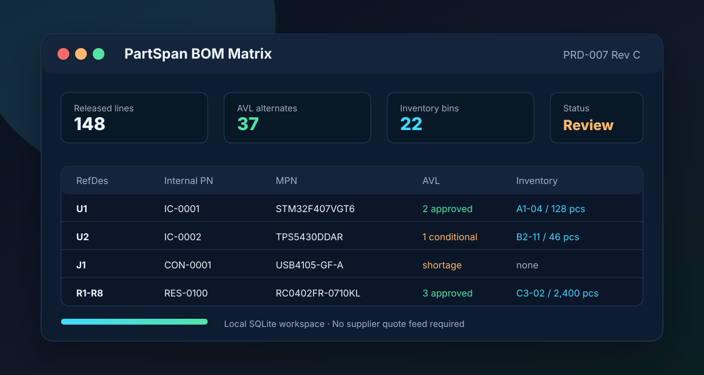

# PartSpan

Local-first BOM, AVL, RefDes, and inventory control for small KiCad hardware teams moving beyond spreadsheet BOM control. 14-day free trial; Pro US$39/year, Team Local US$199/year per site.

[Download PartSpan](https://partspan.evelyn-ai.com/#download) · [Join the pilot](https://partspan.evelyn-ai.com/#pilot) · [Website](https://partspan.evelyn-ai.com/) · [v0.3.0 release](https://github.com/papalon0505/partspan-site/releases/tag/v0.3.0) · [SHA-256 checksums](https://partspan.evelyn-ai.com/SHA256SUMS.txt)

## Why It Exists

Small hardware teams often manage product BOMs in spreadsheets until RefDes, AVL alternates, inventory bins, and revision control become hard to trust. PartSpan keeps that work local in a desktop app, without requiring a supplier quote feed or cloud PLM account.

## What You Get

- KiCad 8/9 BOM import with generated part numbers and DNP handling
- Reference designator check before release
- Released BOM revisions and BOM Matrix
- AVL alternates with review dates
- Inventory bin locations and where-used impact
- Backup and restore of the whole workspace
- Team Local: share one workspace on the office network over HTTPS with viewer, editor, and admin roles
- English and Traditional Chinese interface

## Trial And Pricing

Every installation has a 14-day trial. Afterwards the workspace is read-only until a license is activated; viewing, search, export, and backup always keep working. Pro is US$39/year for one user (first 100 buyers: US$29 for the first year). Team Local is US$199/year per site. PartSpan is closed-source commercial software; this repository hosts the website and installers only.

## Downloads

Current release: [PartSpan Desktop v0.3.0](https://github.com/papalon0505/partspan-site/releases/tag/v0.3.0)

| Platform | Installer |
| --- | --- |
| macOS Apple Silicon | [PartSpan-0.3.0-mac-arm64.dmg](https://github.com/papalon0505/partspan-site/releases/download/v0.3.0/PartSpan-0.3.0-mac-arm64.dmg) |
| Windows x64 | [PartSpan-0.3.0-win-x64.exe](https://github.com/papalon0505/partspan-site/releases/download/v0.3.0/PartSpan-0.3.0-win-x64.exe) |

Verify installers with [SHA256SUMS.txt](https://github.com/papalon0505/partspan-site/releases/download/v0.3.0/SHA256SUMS.txt).

## Pilot Feedback

PartSpan is recruiting hardware teams that currently manage real BOM / AVL / inventory workflows in spreadsheets or lightweight tools.

Use the public site's **Join the pilot** action to open a voluntary GitHub pilot-interest issue. Do not post confidential BOMs, credentials, customer names, proprietary part lists, or other sensitive company information.

Campaign attribution and measurement boundaries are documented in [docs/distribution-measurement.md](docs/distribution-measurement.md).

## Security Notes

- macOS DMG and app are signed, notarized by Apple, and stapled.
- Windows installer is not yet code-signed, so SmartScreen may show a warning.
- BOM data stays in the local workspace database on the user's machine.

## 中文簡介

PartSpan 是給使用 KiCad 的小型硬體團隊的本機 BOM 管理工具，可匯入 KiCad BOM、檢查 RefDes 位號、管理 AVL 替代料與庫存位置，資料不上雲端。14 天免費試用；Pro 每年 US$39，Team Local（同一辦公室網路多人共用）每站每年 US$199。

## Repository Scope

This public repository hosts the product website, public downloads, checksums, and sample BOM material. The private product source remains separate.
